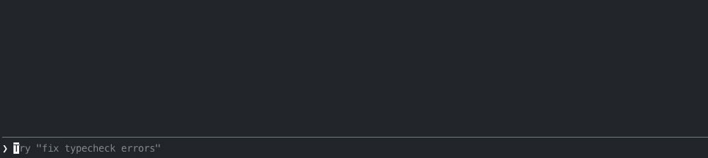

# prompt-image-preview

A Claude Code mod that previews pasted images above the prompt before you send them, and shows the images of each message inside the conversation.



When you paste an image, Claude Code only shows `[Image #1]` in the prompt. This mod draws a thumbnail of each pasted image above the prompt, in a row, with its number under it. Click a thumbnail to open the full image in Preview, or click the black circle with a white x that sits on its top-right corner to take the image out of the prompt. Remove an `[Image #N]` from the prompt and its thumbnail goes away; send the message and the row clears.

## Images in the conversation

Once a message is sent, its images stay visible: each message you sent with images shows them under it, at up to 38 columns wide. Replies show images too:

- an image file the reply names by its path (`/Users/me/out.png`, `~/Desktop/chart.jpg` or a Markdown ``), such as an image Claude just generated
- an image Claude reads with `Read`
- an image an MCP tool returns

Click a picture to open it in Preview. After `--resume`, the images you sent are rebuilt from the session's messages.

The `messageImages` option picks which messages show images: `all` (default), `sent` (only yours) or `off`. Change it in `/plugin` > prompt-image-preview > Configure options.

In a terminal that cannot draw images, each image is listed as `Image #N WIDTHxHEIGHT`: clicking the label opens it, and the `✕` beside it takes it out of the prompt.

## Requirements

- macOS (the mod uses `osascript`, `sips` and `open`)
- Claude Code 2.1.300 or newer (older versions do not have the `prompt.edit` event the mod uses, and do not load it)
- A terminal that draws kitty graphics for thumbnails: Ghostty, kitty, WezTerm, or Orca with the setting below

## Install

At the Claude Code prompt:

```
/plugin install prompt-image-preview --marketplace igarbayo/prompt-image-preview
```

Answer `y` to add the marketplace, then pick a scope.

### Orca

Orca draws kitty graphics, but Claude Code does not detect it as an image-capable terminal and shows text instead. Add this to `~/.zshrc` and open a new tab:

```sh
[[ "$TERM_PROGRAM" == "Orca" ]] && export CLAUDE_CODE_FORCE_TERMINAL_IMAGES=1
```

Inline images must be on in *Settings → Terminal → Inline Images* (the default). Do not run Claude Code inside tmux.

### Install with the skill

`skills/install-prompt-image-preview` installs the plugin and the Orca setting with one script, and can check or undo both:

```sh
bash skills/install-prompt-image-preview/scripts/install.sh install    # or: status, uninstall
```

Copy the skill folder to `~/.claude/skills/` and ask Claude Code to install prompt-image-preview.

## How it works

- When `[Image #N]` appears in the prompt, the image is still on the clipboard. The mod saves it to `~/Library/Caches/claude-prompt-image-preview/<session>/` and makes a small thumbnail. The folder is deleted when the session ends.
- The close button is drawn into the thumbnail itself, over its top-right corner and a transparent margin, so it stays round over any image. Clicking it deletes `[Image #N]` from the prompt, and Claude Code no longer sends that image.
- Thumbnails are redrawn when you type in the prompt.
- When you send a message, the mod reads the images Claude Code sends to the model (not the clipboard) and saves them to the same cache folder. A picture is only drawn while its message is on screen.

## Known limits

- Images dragged in as files are not on the clipboard and show as "not captured".
- If the clipboard changes in the instant between pasting and capturing, the thumbnail can be the wrong image.
- Orca drops images in a tab that is hidden and does not restore them when you come back ([stablyai/orca#32714](https://github.com/stablyai/orca/issues/32714)). Press any key in the prompt to redraw them.
- Terminals have no way for the mod to show a hand cursor over a thumbnail.
- An image Claude saves to disk shows under the reply only when the reply names its path.

## License

MIT
